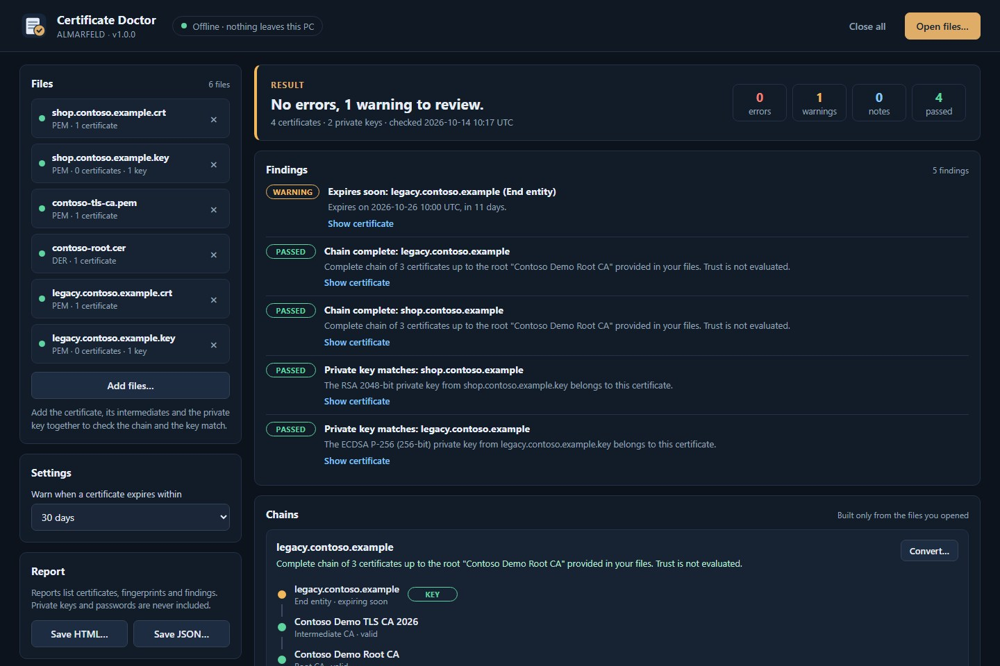

# Certificate Doctor

**Inspect. Check the chain. Convert a copy.**

An offline Windows utility from ALMARFELD for X.509 certificate files. See what a certificate contains, find a missing intermediate or a key that does not match, and convert between PEM, DER, P7B and PFX without uploading anything.

**Certificate Doctor v1.0.0**

[Download the portable ZIP](https://github.com/AlinTibi/CertificateDoctor/releases/download/v1.0.0/CertificateDoctor-v1.0.0-win-x64.zip) · [Release notes and checksums](https://github.com/AlinTibi/CertificateDoctor/releases/tag/v1.0.0) · [Product page](https://almarfeld.com/software/certificate-doctor/)



## Supported formats

| Extension | Content |
| --- | --- |
| `.cer`, `.crt`, `.der` | DER or PEM certificates, including bare base64 |
| `.pem` | Certificates, PKCS#7 bundles and unencrypted private keys |
| `.key` | Unencrypted private keys (PKCS#8, PKCS#1, EC) |
| `.pfx`, `.p12` | PKCS#12 with one private key, or certificate-only stores (modern AES and legacy 3DES/RC2) |
| `.p7b`, `.p7c` | PKCS#7 certificate bundles, DER or PEM |

Content is detected by structure, not by file extension.

## What it does

- Shows subject, issuer, validity and days remaining, Subject Alternative Names (DNS, IP, email, URI), key algorithm and size, signature algorithm, key usage, extended key usage, serial number and SHA-1/SHA-256 fingerprints.
- Builds chains from the files you open and reports a complete chain, a missing issuer (usually a missing intermediate), a chain that ends at an intermediate whose root was not provided, self-signed certificates, issuers that did not actually sign the certificate and issuers that expire first.
- Flags expired, not-yet-valid and soon-to-expire certificates (7–90 days, default 30), RSA keys under 2048 bits and SHA-1/MD5 signatures.
- Checks whether each private key matches a certificate.
- Converts a selected chain **to a new file**: PEM chain, DER certificate, P7B chain, PFX with the matching key (new password, AES-256), PEM chain with key, or the key alone.
- Saves an HTML or JSON report with certificates, fingerprints and findings.

## Not in v1.0

Certificate Doctor v1.0 does **not**:

- check revocation (no OCSP or CRL requests);
- download missing certificates (no AIA fetching) — chains use only the files you open;
- evaluate trust against the Windows certificate store or any other trust store;
- validate hostnames, certificate policies or name constraints;
- generate CSRs, sign, or edit certificates or keys;
- decrypt encrypted PEM private keys or open PKCS#12 files that contain several private keys.

A "complete chain" means the certificates link correctly by name and signature up to a root you provided. It does not mean a browser or server will trust it.

## Privacy and safety

- Fully offline: no network access, accounts, telemetry, analytics, ads or automatic updates.
- PFX passwords are used once to open the file and stay in memory only. They are never stored, logged or included in reports.
- Private keys are never logged and are written to disk only when you explicitly choose a conversion that includes a key. Unencrypted key outputs show a warning first.
- The original files are never modified. Every conversion and report is a new file; existing files are refused.
- Reports contain certificate details and fingerprints, never key material or passwords. Files are named by basename only.
- Closing a file or choosing **Close all** releases its certificates and keys from the application.

## Run Certificate Doctor

Windows 10/11 x64. Extract the entire portable ZIP into a folder and run **CertificateDoctor.exe**. No installation is needed. The separate **Microsoft Edge WebView2 Runtime** is required; it is already present on current Windows 10/11, otherwise use the [official Microsoft download](https://developer.microsoft.com/microsoft-edge/webview2/). Nothing installs automatically.

The executable is **not Authenticode signed**, so Windows SmartScreen may show a warning. Verify the download with the published SHA-256 checksum first:

```powershell
Get-FileHash .\CertificateDoctor-v1.0.0-win-x64.zip -Algorithm SHA256
```

Compare the result with `CertificateDoctor-v1.0.0-win-x64.zip.sha256` from the release page. Do not disable Windows security.

## How to use it

1. Open one or more certificate, key, PFX or P7B files, or drop them onto the window. Open the certificate, its intermediates and its private key together for a full check.
2. Enter the password for a protected PFX next to the file. An incorrect password is reported there; nothing else changes.
3. Read the result and findings. Select **Show certificate** for full details and copy fingerprints.
4. Select **Convert…** on a chain, choose the output format and save a new file.
5. Save an HTML or JSON report if you need a record.

## Limits

- 8 MiB per file and up to 32 files at a time.
- Chain building uses name matching and signature verification only.
- New PFX files use AES-256-CBC, PBKDF2-SHA256 and an SHA-256 MAC. Very old systems (before Windows 10 1709, OpenSSL 1.1.1 or Java 11) may not open them.
- Output files inherit the permissions of the folder you save them in. Store private keys in a protected location.

## Build and test

Go version is specified in `go.mod`; Node 22 is specified in `.node-version`. The Wails CLI must match the dependency exactly.

```powershell
cd frontend
npm ci
npm test
npm run build
cd ..
go vet ./...
go test ./...
go install github.com/wailsapp/wails/v2/cmd/wails@v2.16.0
wails build -clean -s -webview2 browser
./scripts/package.ps1 -Version 1.0.0
```

All test certificates and keys are generated during the tests; none are stored in the repository. Tests cover every supported format, PFX password handling, chain building, missing issuers, signature mismatches, expiry states, weak keys, key matching, all conversions as round trips, OpenSSL interoperability (when `openssl` is available), never-overwrite behavior and reports without secrets.

MIT license. [Source](https://github.com/AlinTibi/CertificateDoctor) · [Support](https://almarfeld.com/support/) · [Security](https://almarfeld.com/security/)
